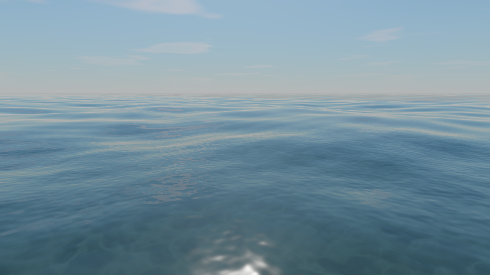
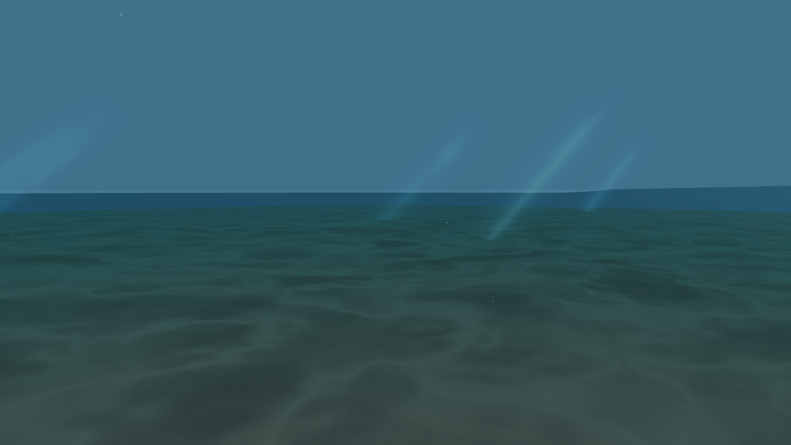

# Photoreal Ocean — Three.js WebGPU + TSL

A real-time ocean and underwater environment built with **Three.js r186**, the
**WebGPU renderer** and **TSL (Three.js Shading Language)** node materials.

The scene contains a multi-scale wave field, a physically based water surface
(Fresnel reflection of an analytic sky, GGX sun glitter, wave driven refraction,
foam), a fully procedural sandy seabed with moving caustics, underwater light
shafts, suspended sediment and Beer-Lambert water absorption.




---

## Running it

```bash
npm install
npm run dev          # http://127.0.0.1:5173
```

Production build:

```bash
npm run build        # type checks with tsc and bundles with vite
npm run preview
```

Requirements: a browser with **WebGPU** (Chrome/Edge 113+, Safari 18+,
Firefox 141+) for the primary path, or **WebGL 2** for the fallback. The demo
detects both at start-up, shows which one is active in the HUD and lets you
switch between them at runtime.

---

## Controls

| Input | Action |
| --- | --- |
| Left drag | Orbit the camera (the polar angle is free, so the camera can dive below the water line) |
| Right drag / Shift + drag | Pan |
| Wheel / Pinch | Zoom |
| `1` `2` `3` | Above water / water line / underwater viewpoints |
| Control panel | All simulation parameters, live |

The panel exposes wave amplitude, speed, spatial scale, crest sharpness, foam,
reflection strength, water depth, clarity, underwater visibility, sun elevation
and azimuth, sun intensity, turbidity, Rayleigh coefficient, cloud cover,
caustics, light shafts, particle density, quality preset and exposure.

---

## Architecture

```
src/
  App.tsx                     React shell: canvas host, HUD, backend switch
  ui/ControlPanel.tsx         GUI generated from the parameter schema
  engine/
    OceanEngine.ts            renderer, scene graph, animation loop, resize, dispose
    cameraRig.ts              orbit rig that can cross the water line
    params.ts                 parameter schema (drives the GUI and the uniforms)
    quality.ts                quality presets (tessellation, particles, shadows)
    tsl/
      uniforms.ts             shared uniform block + radiometric constants
      math.ts                 loosely typed TSL helpers
      noise.ts                gradient noise with analytic derivatives
      waves.ts                wave spectrum, displacement and normals
      sky.ts                  Preetham sky + procedural clouds
      water.ts                Fresnel, GGX, absorption and in scattering
      seabedField.ts          seabed depth, dunes, ripples, sand albedo
      sand.ts                 shared sea floor shading (sun, sky, caustics)
      caustics.ts             caustic pattern projected onto the sand
    objects/
      SkyDome.ts  OceanSurface.ts  Seabed.ts
      Particles.ts  LightShafts.ts  radialGrid.ts
```

The 3D runtime is completely framework agnostic: `OceanEngine` owns a DOM
element and creates its own canvas, so it can be dropped into a React Three
Fiber app (`<primitive>`/an effect), a plain page or any other host. The React
layer here only provides the UI.

---

## Technical approach

### Wave field

Seven directional wave trains (74 m … 5.3 m) are summed with a drifting fBm
"swell" term. The wavelengths are incommensurate and the phases are fixed so
the pattern never visibly repeats, and the frequencies follow the deep water
dispersion relation `ω = √(gk)`.

The height is evaluated in the vertex stage (displacement) and the full
surface sample — height plus the analytic gradient — is evaluated per fragment
so the shading normal always matches the displaced geometry. Small waves fade
out with the distance **to the camera** (not to the centre of the grid), so
the level of detail stays stable while the camera orbits. Fine ripples are
added as a shading-only detail layer.

The analytic derivative of the fBm swell has to be scaled with the spatial
frequency the noise argument was scaled with. Without that factor the swell
contributes a slope that is larger than the one of the wave trains, which
turns the water into noise and floods the whole surface with foam.

### Water surface

The surface material is **opaque and self contained**: it evaluates the
reflection *and* the transmission in one pass, so the energy is split
correctly and the sea floor is shaded with exactly the same code that the
underwater view uses.

* **Reflection** – the reflected ray is evaluated with the *same* analytic sky
  function that renders the sky dome, so the water always mirrors the sky that
  is actually visible (including the clouds). A reflected ray that dips below
  the horizon cannot reach the sky; it is folded back onto the horizon so that
  a wave face tilted away from the viewer shows a plausible sky instead of a
  black hole.
* **Fresnel** – the *exact* dielectric Fresnel equations (not Schlick).
  Schlick is noticeably wrong between 40 and 80 degrees of incidence, which is
  exactly the band the ocean surface is seen from. The reflection now rises
  smoothly towards 1 at grazing angles and the water stays transparent when
  the camera looks straight down into it.
* **Sun glitter** – a GGX lobe (roughness 0.14) produces the moving sparkle
  path. The highlight is energy limited: it is a mirror of the sun, not a
  blown-out white plate.
* **Refraction** – the eye ray is refracted through the animated surface and
  intersected with the sea floor, so the sea floor visibly wobbles; the
  length of that path drives the Beer-Lambert absorption. The light that
  reaches the floor is lit by the sun, the sky and the moving caustics.
* **Water body** – what is missing on the way back is added as the
  in-scattering of the water column. This is what keeps the deep water blue
  instead of black; without it the ocean turns into a mirror of the sky and
  the deep water disappears.
* **Foam** – white caps where the large waves become steep enough to break,
  broken up by two noise octaves so they read as streaks rather than patches.
* **From below** – a second material renders the Snell window: inside the
  critical angle the sky is visible (compressed by refraction and attenuated
  by the water column), outside of it total internal reflection takes over.

### Underwater

* The sand is fully procedural: albedo variation, mineral specks, shell
  fragments, dunes (geometry) and directional ripples (shading). Its shading
  lives in `tsl/sand.ts` and is shared by the sea floor mesh and by the ocean
  surface, so the shallow water and the underwater view always agree.
* Caustics are a network of bright filaments warped by the gradient of the
  wave field, so they drift and focus with the waves. Their contrast is kept
  moderate: the sea floor has to read as a soft bottom and not compete with
  the water surface.
* Absorption uses the per-channel extinction coefficients of clear ocean water
  (Jerlov type I) scaled by the visibility and clarity controls, with
  in-scattering added along the path.
* Light shafts are camera-facing quads that follow the sun direction down into
  the water, modulated by a scrolling noise field.
* Suspended particles are camera-facing quads with a soft radial falloff and a
  forward scattering term, attenuated by the same water model.

### Lighting and colour

The sky is a Preetham daylight model with a procedural cloud layer. Two details
of the model matter a lot for the look:

* The Rayleigh phase function is `3/(16π) · (1 + cos²θ)`. Dropping the
  additive `1` makes the in-scattering collapse towards the anti-solar half of
  the sky: the water turns almost black when the camera faces away from the
  sun and blown out when it faces the sun, which is exactly the artefact this
  scene has to avoid.
* The Preetham aureole around the sun is orders of magnitude brighter than the
  rest of the dome. The scattered light is therefore compressed towards a
  ceiling (a shoulder that is applied to the luminance only, so the sky keeps
  its hue). Without it a large part of the sky clips to a flat white sheet.
  The solar disc itself is added after the shoulder and stays a disc.

The whole scene is rendered in linear HDR and tone mapped with AgX; the sky
dome, the water and the sea floor all go through the same renderer, so they
share one exposure and one tone curve and no colour space conversion is
applied twice. `SUN_IRRADIANCE` in `tsl/uniforms.ts` ties the sun's irradiance
to the sky's radiance so that the balance between sky reflection, sunlit sand
and specular highlights matches what a camera would record.

---

## WebGPU and the WebGL 2 fallback

The renderer is always a `WebGPURenderer`:

* **WebGPU** – `new WebGPURenderer({ canvas })`. If the adapter request fails,
  three.js falls back to the WebGL 2 backend on its own and the demo reports
  the active backend in the HUD.
* **WebGL 2** – `new WebGPURenderer({ canvas, forceWebGL: true })`, which
  compiles the *same* TSL node materials to GLSL through three's WebGL node
  backend.

Using the node pipeline for both backends means there is only one shader
implementation to maintain and no risk of the two paths drifting apart. The
materials avoid everything that is WebGPU only (no compute shaders, no storage
buffers, no subgroups), so the identical TSL graph runs on both backends.

Each engine instance creates its **own canvas**: a canvas can only ever hold
one WebGL context, so switching the backend means a fresh canvas element, not
a reused one.

---

## Trade-offs and limitations

* **No screen space reflections.** The water mirrors the analytic sky instead
  of the scene, so objects that are not the sky (there are none in the demo)
  are not reflected. This is both cheaper and more correct for an open sea.
* **Refraction is analytic, not a screen space pass.** The eye ray is refracted
  through the wave normal and intersected with the sea floor height field.
  This gives the correct wobble of the sea floor without an extra render
  target, but it cannot refract geometry that is not part of the sea floor.
* **The sea floor mesh is only rendered underwater.** From above the water the
  surface shades the sea floor itself (with the same code), so the separate
  mesh would only cost fill rate.
* **Total internal reflection is approximated.** Seen from below, the region
  outside Snell's window shows the in-scattering colour instead of a mirrored
  image of the underwater scene.
* **The horizon is a flat plane.** No earth curvature and no wave-driven
  horizon occlusion (the waves are not tall enough at the horizon to hide it).
* **Caustics are a procedural approximation** of the focusing of the refracted
  sunlight; they do not come from a photon map or a caustic solve.
* **The wave field is height-field based.** There is no Gerstner horizontal
  displacement, so the crests are less pointed than in a full spectral model.
* **The ocean grid is centred on the world origin** and does not follow the
  camera, so orbiting far away reduces the geometric detail. The shading
  normal stays correct at any distance.

---

## Performance

* GPU procedural everything: no textures, no render targets for the water, no
  post-processing chain.
* The ocean and the seabed use a polar grid whose ring radii grow
  geometrically, which keeps the vertex density high near the camera while
  still reaching the horizon without a visible edge.
* The sky function (the most expensive part) is evaluated once per fragment
  and only for the branch that is actually visible — the surface uses two
  materials, one for above water and one for below water.
* Quality presets scale the tessellation, the particle count, the number of
  light shafts and the soft shadow lookup on the dunes. `Auto` lets the engine
  step the preset down by itself when the frame rate collapses (it never
  oscillates back up).

The live FPS, triangle count and draw call count are shown in the HUD.
